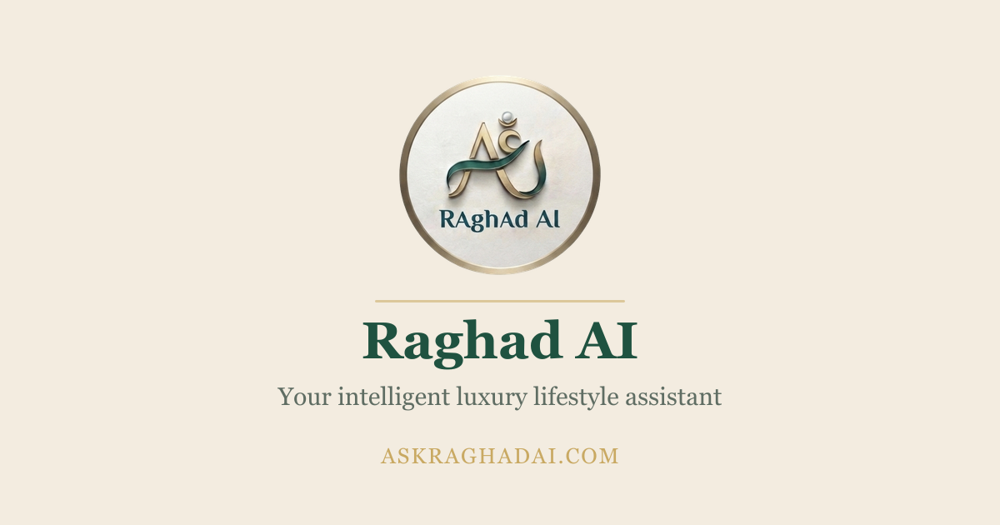
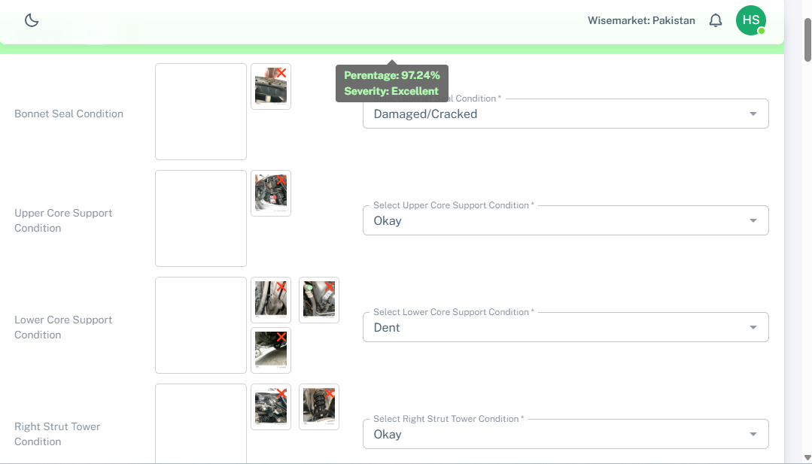
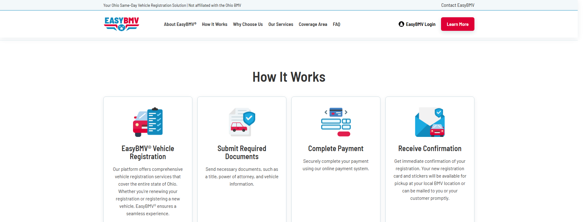
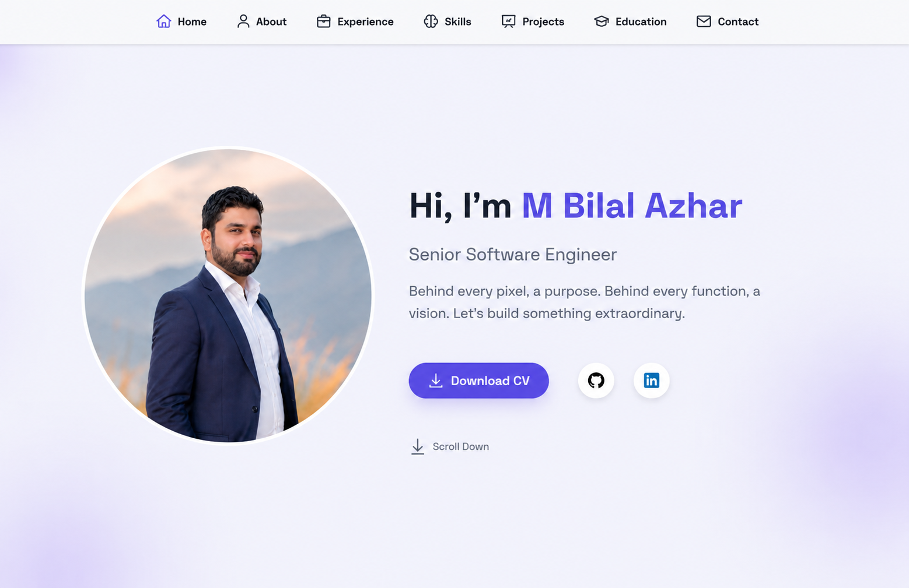

# Bilal Azhar Portfolio

A modern React portfolio website for presenting professional experience, technical skills, selected projects, education, resume, and contact links.

## What Is Built

- Responsive portfolio homepage
- Animated hero section with profile image
- Experience timeline
- Skills section
- Project showcase
- Education section
- Resume download link
- Contact and social links

## Tech Stack

- React
- Create React App
- CSS
- Framer Motion
- React Icons
- Lucide React

## Project Preview

### Ask Raghad AI



### Wise Wheels



### EasyBMV



### E-commerce


### Portfolio Website



## Getting Started

Install dependencies:

```bash
npm install
```

Start the development server:

```bash
npm start
```

Open the app in your browser:

```text
http://localhost:3000
```

If port `3000` is already busy, run it on another port:

```powershell
$env:PORT=3001; npm start
```

Then open:

```text
http://localhost:3001
```

## Production Build

Create a production build:

```bash
npm run build
```

The optimized output will be generated in the `build` folder.

## Available Scripts

```bash
npm start
```

Runs the app in development mode.

```bash
npm run build
```

Builds the app for production.

```bash
npm test
```

Runs the test watcher.
